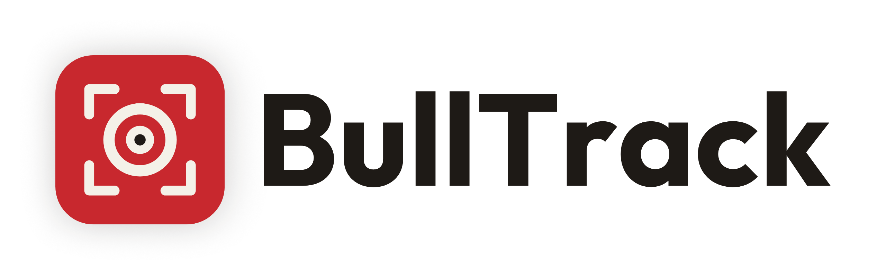
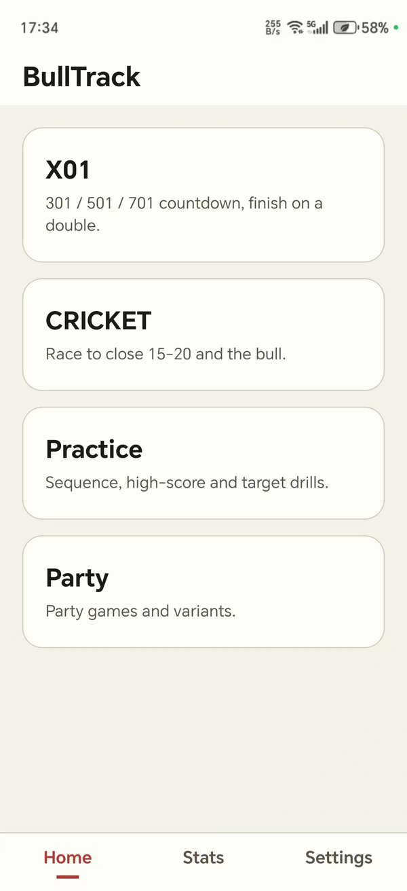
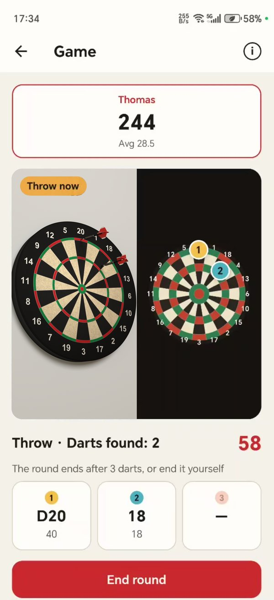
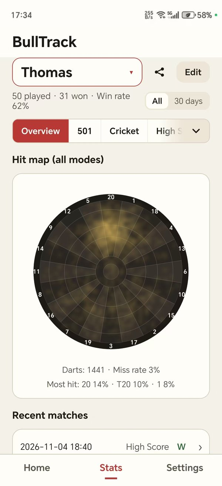
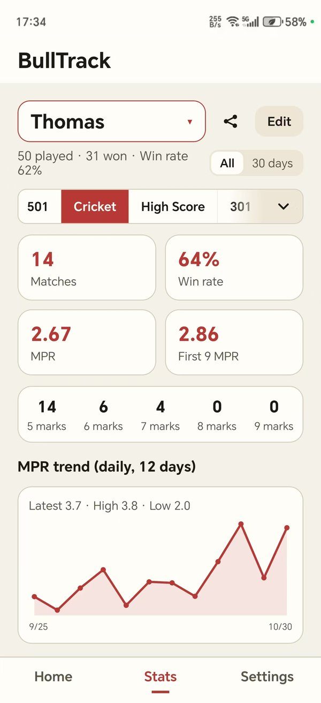

<div align="center">

<picture>
  <source media="(prefers-color-scheme: dark)" srcset="asset/github/readme-header-dark.png">
  
</picture>

**A free, open-source darts scoring app that spots every dart automatically. All it needs is an Android phone and a stand.**

Steel-tip and soft-tip boards · Detection runs on the phone, fully offline · No ads, no account

[](../../releases)
[-3DDC84)](#download)
[](#download)
[](../../releases)
[](https://reactnative.dev)
[](LICENSE)

English | [简体中文](README.zh-CN.md)

</div>

## Why BullTrack

- **No extra hardware**: no electronic board, dedicated camera or computer. One Android phone and a stand are enough.
- **Steel-tip and soft-tip**: works with bristle boards (red and green rings) and soft-tip boards (red and blue rings); pick your board type in Settings.
- **Automatic scoring and long-term stats**: the phone finds where each dart lands, scores it, keeps the game score and tracks every player's stats over time.
- **Free, open source, offline**: all detection runs on the phone, match records stay on the phone, and no data is uploaded.

<table>
  <tr>
    <td></td>
    <td></td>
    <td></td>
    <td></td>
  </tr>
</table>

## Features

- **Auto scoring**: each dart is detected and scored as it lands. If one is wrong, drag its marker on the virtual board or pick the right score.
- **Placement guide**: step-by-step help for setting up the phone; the camera zooms to the board automatically.
- **Games**:
  - X01: 301 / 501 / 701
  - Cricket: Standard, No Score, Tactics, Cut Throat, Random, Hammer
  - Others: Shanghai, Half It, Bermuda, Gotcha 301, Killer, Catch 40, 41-60
  - Practice: Around the Clock, High Score, 99 Darts at 20
  - 1-4 players, or 2-4 teams; every game has its rules built in
- **Stats**: follow your progress with each player's overview and per-game figures (X01 average, Cricket MPR, trend charts and more), head-to-head records and hit maps, and turn any of them into a share image.
- **Sound cues**: different sounds for doubles, trebles and the bull, so you can stay on the oche without looking at the screen.
- **More**: undo the last round; rename, merge and delete players; back up and restore match history; English and Chinese UI.

## Download

Download the APK from [Releases](../../releases).

- A 64-bit phone with Android 8.0 or later and a rear camera.
- Detection uses the GPU when the phone supports Vulkan, and falls back to the CPU otherwise.

## How to use

1. Mount the phone on a stand **in front of the board, to the left or right**, aimed at it at an angle (15°–45° off straight on, no steeper). Place it between the oche and the board, a little closer to the board.
2. Keep the whole board in view, well lit and free of strong glare. The app zooms in automatically; you can also use the slider beside the preview.
3. Pull all darts out of the board before each round. Tap "Start round" and throw once you see "Throw now". Don't touch the phone or the stand while throwing.

The in-app "Placement guide" (the "?" button on the preview, or in Settings) shows this with pictures.

## Known limitations

- Very transparent or pale shafts and flights, or boards with unusual colours, may not be detected.
- Darts landing very close together or hidden behind each other are occasionally misread and need correcting.
- Android only for now.
- Tested on only a few phones so far. If you run into problems on yours, please [report them](#reporting-issues).

## How it works

BullTrack combines the board's colour features with a YOLO model to find where each dart lands. During a round it checks the board every 0.5 seconds, maps each landing point onto a standard dartboard and works out the segment and score.

## Reporting issues

If detection goes wrong, please attach a debug bundle to your issue:

1. In Settings, tap the version line at the bottom 7 times to turn on developer mode, then turn on "Show debug info".
2. Play a round where the problem happens, then tap "View debug images" on the home screen, select that round and tap "Export debug bundle".

The bundle holds that round's debug images, its log and your phone model. The debug images show what the camera saw, so look through them before sharing.

## Project structure

```
mobile/            React Native app: UI, game rules, statistics, storage
bulltrack-core/    Android library: camera and dart detection (C++, Kotlin)
scripts/           Build dependency download
```

## Building from source

<details>
<summary>Requirements and build steps</summary>

Requirements: Node.js ≥ 22.11, JDK ≥ 17, Android SDK 36, NDK 27.1.12297006, CMake 3.22.1.

```sh
git clone https://github.com/Thomasff/BullTrack.git
cd BullTrack
node scripts/fetch-native-deps.js    # OpenCV 4.12.0 and ncnn 20260113 prebuilt packages (~340 MB, SHA-256 checked)
# Download model.ncnn.param / model.ncnn.bin from the model-v1 release (https://github.com/Thomasff/BullTrack/releases/tag/model-v1) into bulltrack-core/src/main/assets/ncnn/
cd mobile && npm install
cd android && ./gradlew :app:assembleRelease -PreactNativeArchitectures=arm64-v8a
```

Output: `mobile/android/app/build/outputs/apk/release/app-release.apk`.

- Without a signing config, the release build uses React Native's default debug keystore; for your own key, see `BULLTRACK_SIGNING_PROPERTIES` in `mobile/android/app/build.gradle`.
- On Windows, long paths can make CMake fail; keep the checkout on a short path.
- Detection needs a real device; an emulator is only good for the UI.
- Type checks, lint and unit tests (in `mobile/`): `npx tsc --noEmit`, `npx eslint src __tests__ jest`, `npx jest`.

</details>

## License

Copyright (C) 2026 Thomasff

Released under the [GNU AGPL-3.0](LICENSE) or any later version (AGPL-3.0-or-later). The detection model is trained with Ultralytics YOLO11s, and Ultralytics requires models trained with its tools to be released under AGPL-3.0 as well.

Third-party components and their licenses are listed in [THIRD_PARTY_NOTICES.md](THIRD_PARTY_NOTICES.md); the main ones are OpenCV (Apache-2.0), ncnn (BSD-3-Clause) and React Native (MIT).
