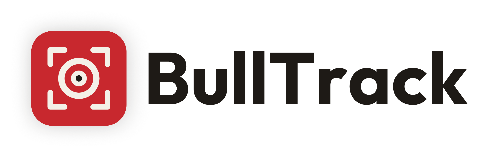
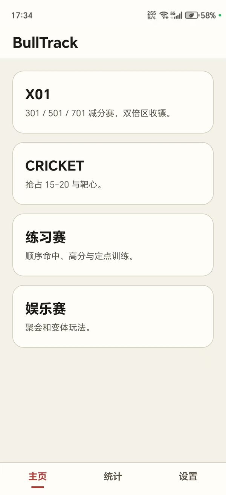
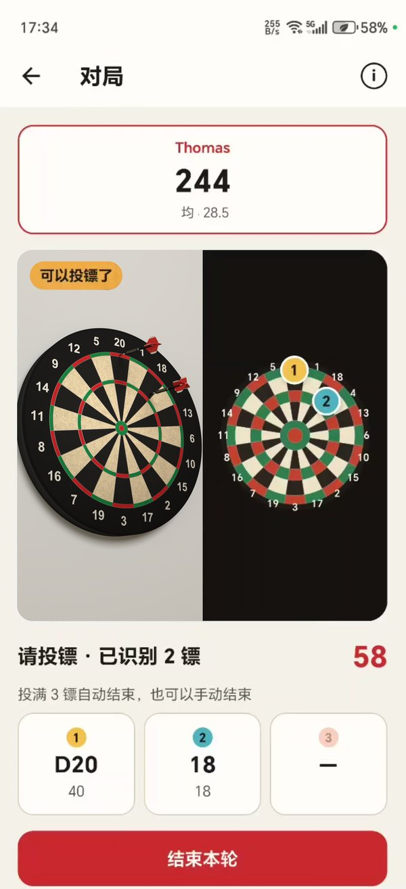
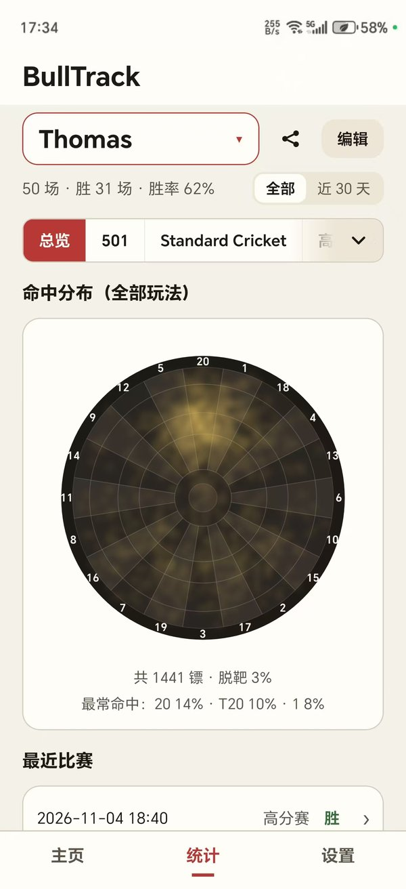
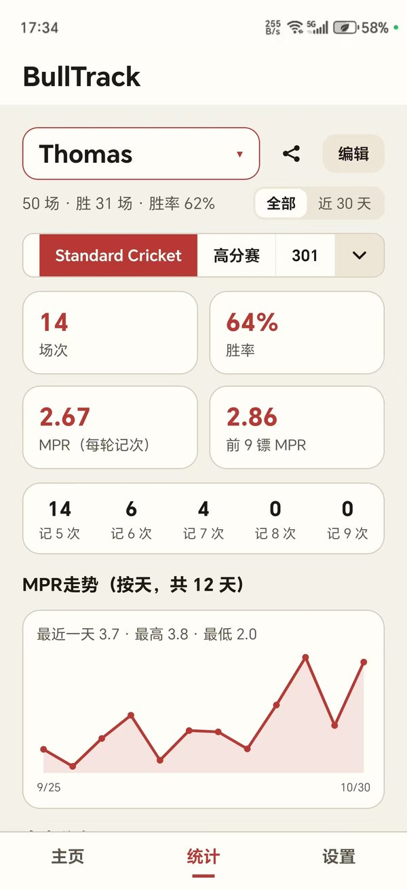

<div align="center">

<picture>
  <source media="(prefers-color-scheme: dark)" srcset="asset/github/readme-header-dark.png">
  
</picture>

**免费开源的飞镖自动识别计分 App：只需一个安卓手机和支架**

支持钢镖和软式飞镖 · 识别全在手机上完成，不联网 · 无广告、不用注册

[](../../releases)
[-3DDC84)](#下载安装)
[](#下载安装)
[](../../releases)
[](https://reactnative.dev)
[](LICENSE)

[English](README.md) | 简体中文

</div>

## 为什么用 BullTrack

- **不用额外硬件**：不需要电子靶、专用摄像头或电脑，只需一部安卓手机和一个支架。
- **软式、钢镖都支持**：软式飞镖靶（红蓝配色）和钢镖剑麻靶（红绿配色）都能识别，在设置里选靶子类型即可。
- **自动记分、统计长期数据**：手机自动认出每一镖的落点，计算分数、游戏比分，支持记录多人长期数据。
- **免费、开源、不联网**：所有识别在手机本地完成，比赛记录只存在手机上，不上传任何数据。

<table>
  <tr>
    <td></td>
    <td></td>
    <td></td>
    <td></td>
  </tr>
</table>

## 详细功能

- **自动计分**：每投一镖自动认出落点并计分；识别错了可以在虚拟靶上拖动标记修正，也可以选择分数直接修改。
- **摆放引导**：详细的摆放引导；拍摄时自动变焦；
- **玩法**：
  - X01：301 / 501 / 701
  - Cricket：Standard、No Score、Tactics、Cut Throat、Random、Hammer
  - 其他：Shanghai、Half it、Bermuda、Gotcha 301、Killer、Catch 40、41-60
  - 练习：Around the clock、高分赛、99 Darts at 20
  - 个人 1-4 人，或 2-4 队组队；每种玩法都有规则说明
- **统计**：记录个人进步，免费查看每个玩家的总览和分玩法数据（X01 均分、Cricket MPR、走势图等）、两人对战记录、落点热图，可一键生成分享图。
- **提示音**：按落点区域（双倍、三倍、牛眼）播放不同的声音，站在投掷线上不用看屏幕。
- **其他**：撤销上一轮；改名、合并、删除玩家；比赛记录备份到文件和导入；

## 下载安装

从 [Releases](../../releases) 下载 APK 安装。

- Android 8.0 及以上的 64 位手机，需要后置摄像头。
- 手机支持 Vulkan 时用 GPU 识别，否则自动改用 CPU。

## 使用方法

1. 手机用支架固定在靶子的**左前方或右前方**，斜着对准靶子（偏离正前方 15°–45°，不可太斜），前后位置在投掷线和靶子之间、稍靠近靶子。
2. 整个靶面要在画面里，光线充足、靶面没有强反光。App 会自动变焦，也可以用预览右侧的滑杆手动调。
3. 每轮开始前把靶上的镖拔掉。点“开始本轮”，看到“可以投镖了”再投，投镖时别碰手机和支架。

App 里的「摆放指南」（预览上的「?」按钮，或设置里）有图示。

## 已知局限

- 镖杆、镖翼太透明或颜色太浅，或者靶子配色特殊，可能导致识别失败。
- 飞镖距离很近或者被遮挡时，偶尔会识别错误，需要纠正。
- 目前只支持 Android。

## 工作原理

结合靶面颜色特征和 YOLO 模型识别飞镖落点。每轮中每 0.5 秒识别一次，把落点换算到标准靶盘上，得出分区和得分。

## 反馈问题

识别出错时，提 issue 最好附上调试包：

1. 在「设置」页底部的版本号上连点 7 下，打开开发者模式，再打开「显示调试信息」。
2. 再打一轮出问题的情况，然后在主页点「查看调试图」，选中那一轮，点「导出调试包」。

调试包里包含这一轮的调试图、日志和手机型号，调试图里能看到拍到的画面，分享前建议自己看一下。

## 项目结构

```
mobile/            React Native App：界面、玩法规则、统计、存储
bulltrack-core/    安卓原生库：相机与飞镖识别（C++、Kotlin）
scripts/           编译依赖下载脚本
```

## 从源码编译

<details>
<summary>环境要求与编译步骤</summary>

环境：Node.js ≥ 22.11、JDK ≥ 17、Android SDK 36、NDK 27.1.12297006、CMake 3.22.1。

```sh
git clone https://github.com/Thomasff/BullTrack.git
cd BullTrack
node scripts/fetch-native-deps.js    # OpenCV 4.12.0、ncnn 20260113 预编译包（约 340 MB，校验 SHA-256）
# 从 model-v1 Release（https://github.com/Thomasff/BullTrack/releases/tag/model-v1）下载 model.ncnn.param / model.ncnn.bin，放到 bulltrack-core/src/main/assets/ncnn/
cd mobile && npm install
cd android && ./gradlew :app:assembleRelease -PreactNativeArchitectures=arm64-v8a
```

产物：`mobile/android/app/build/outputs/apk/release/app-release.apk`。

- 未配置签名时使用 React Native 默认的 debug keystore；自定义签名见 `mobile/android/app/build.gradle` 中的 `BULLTRACK_SIGNING_PROPERTIES`。
- Windows 下路径过长可能导致 CMake 失败，建议放在短路径下。
- 识别依赖真机，模拟器仅能调试界面。
- 静态检查与单元测试（`mobile/` 下）：`npx tsc --noEmit`、`npx eslint src __tests__ jest`、`npx jest`。

</details>

## 许可证

Copyright (C) 2026 Thomasff

按 [GNU AGPL-3.0](LICENSE) 或更高版本发布（AGPL-3.0-or-later）。识别模型基于 Ultralytics YOLO11s 训练，Ultralytics 要求用其工具训练的模型同样遵守 AGPL-3.0。

用到的第三方组件及其许可证见 [THIRD_PARTY_NOTICES.md](THIRD_PARTY_NOTICES.md)，主要有 OpenCV（Apache-2.0）、ncnn（BSD-3-Clause）、React Native（MIT）。
